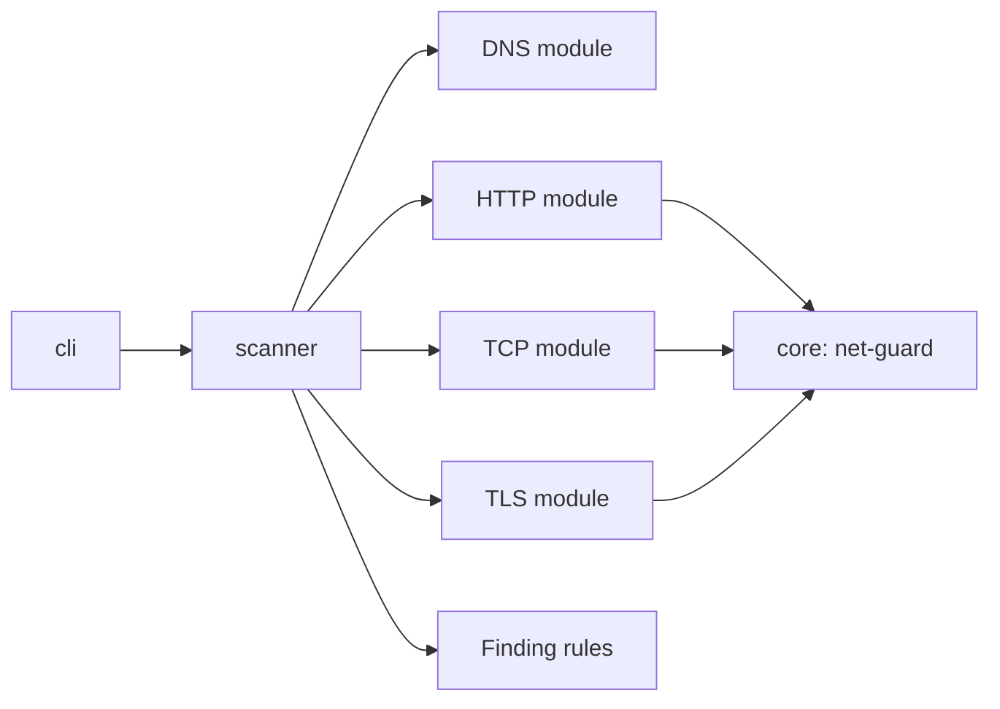

# Sentinel

A defensive, evidence-first web reconnaissance scanner: DNS, HTTP, TCP and TLS checks with SSRF-safe networking and schema-validated reports.

[](https://github.com/MounibAhmedAggoun/Sentinel/actions/workflows/ci.yml)
[](LICENSE)

> **Authorized use only.** Scan only systems you own or have explicit
> written permission to test.

## Why Sentinel exists

Most scanners either do too much (exploitation, fuzzing) or give one vague score.
Sentinel only observes: it checks how a domain is configured and reports what it
saw, with the evidence, and never claims a target is "vulnerable". It is built to
be safe to run, so the scanner itself resists being used against internal networks.

## Quick start

Requires Node.js 22 or newer.

```bash
git clone https://github.com/MounibAhmedAggoun/Sentinel.git
cd Sentinel
npm ci
npm run build --workspace cli
node cli/dist/index.js scan example.com
```

Or with Docker:

```bash
docker build -t sentinel .
docker run --rm sentinel scan example.com
```

Save a report in another format by redirecting the output (log lines go to
stderr, so they stay out of the file):

```bash
node cli/dist/index.js scan example.com --format html > report.html
node cli/dist/index.js scan example.com --format markdown > report.md
node cli/dist/index.js scan example.com --json report.json
node cli/dist/index.js validate report.json
```

## Sample output

A real scan of `example.com`:

```
Findings: 11 (0 high, 0 medium, 6 low, 5 informational)

SEVERITY       RULE      FINDING
-------------  --------  --------------------------------------------------------------------------------
LOW            HTTP-001  Security header not observed: Content-Security-Policy
LOW            HTTP-002  Security header not observed: Strict-Transport-Security
LOW            HTTP-003  Security header not observed: X-Content-Type-Options
LOW            HTTP-004  Security header not observed: X-Frame-Options or CSP frame-ancestors
LOW            HTTP-005  Security header not observed: Referrer-Policy
LOW            HTTP-008  Redirect from HTTP to HTTPS not observed
INFORMATIONAL  DNS-003   CAA record not observed
INFORMATIONAL  TCP-001   TCP port 80 observed open
INFORMATIONAL  TCP-001   TCP port 443 observed open
INFORMATIONAL  TCP-001   TCP port 8080 observed open
INFORMATIONAL  TCP-001   TCP port 8443 observed open
```

A full report is in [`docs/example-report.json`](docs/example-report.json), and the
format is described by [`docs/report.schema.json`](docs/report.schema.json).

## What it checks

| Area    | What is observed                                                                                                |
| ------- | --------------------------------------------------------------------------------------------------------------- |
| DNS     | SPF, DMARC and CAA records: missing, permissive, monitoring-only, or without an enforcing policy                |
| HTTP    | Missing or weak CSP, HSTS (missing or short max-age), X-Content-Type-Options, frame protection, Referrer-Policy |
| HTTP    | Version details in the Server and X-Powered-By headers, and no redirect from HTTP to HTTPS                      |
| Cookies | Missing Secure, HttpOnly or SameSite, and SameSite=None without Secure                                          |
| TCP     | Open ports from a fixed allowlist, with a higher severity for sensitive services such as Telnet and RDP         |
| TLS     | Expired, expiring or self-signed certificates, hostname mismatch, untrusted chain, legacy protocols, no TLS 1.3 |

Every finding has a stable rule ID, evidence and remediation guidance. A check that
fails (a timeout, a refused connection) is listed as a check that did not complete,
never as a finding.

## Options

| Option                     | Meaning                                                                              |
| -------------------------- | ------------------------------------------------------------------------------------ |
| `--ports <list>`           | Ports to check, from the allowlist, e.g. `80,443`                                    |
| `--format <name>`          | Print `table` (default), `markdown` or `html`                                        |
| `--fail-on <severity>`     | Exit 1 on a finding at or above `informational`, `low` (default), `medium` or `high` |
| `--only <rules>`           | Report only these rules, e.g. `HTTP-001,TLS-002`                                     |
| `--skip <rules>`           | Leave these rules out of the report, e.g. `DNS-003`                                  |
| `--json <file>`            | Also write the full report to a JSON file                                            |
| `--max-duration <seconds>` | Stop the scan after this long (1 to 3600, default 120)                               |
| `--timeout <seconds>`      | Limit for each HTTP request, TCP connection and TLS handshake (1 to 60)              |
| `--concurrency <number>`   | TCP port checks run at once (1 to 20, default 5)                                     |
| `--probe-legacy-tls`       | Also probe for TLS 1.0, 1.1 and 1.3 support (a few extra handshakes)                 |
| `--allow-private`          | Allow private and loopback addresses, for local testing only                         |

Exit codes: `0` clean, `1` findings at or above the `--fail-on` severity (default
`low`), `2` usage error, `3` scan error (including a scan that exceeds
`--max-duration`).

`--only` and `--skip` choose which findings are reported. The scan still runs every
check, and the two options cannot be used together. To see every rule and its ID:

```bash
node cli/dist/index.js rules list
```

## Safety model

- **Target checks.** Every target passes a shape check, then net-guard resolves it
  and rejects private, loopback, link-local and reserved addresses. If any resolved
  address is blocked, the whole target is rejected.
- **No second lookup.** Connections go only to the IP that was validated, so DNS
  rebinding cannot swap the address. Redirects are re-checked on every hop.
- **Cloud metadata stays blocked.** Link-local addresses such as `169.254.169.254`
  are blocked even with `--allow-private`.
- **No general port scanning.** Ports come from a fixed allowlist.
- **Limits.** A global deadline, per-request timeouts and a concurrency cap.
- **Reports hold no secrets.** Cookie values are never stored, only an allowlist of
  response headers is kept, and URL query strings are replaced with `?[redacted]`.
  Report files are written with owner-only permissions.
- **Hostile text.** Text from the scanned server is sanitized before it is printed
  and escaped in Markdown and HTML output.
- **The guard is tested hard.** A table of bypass attempts
  ([`core/src/ssrf-corpus.test.ts`](core/src/ssrf-corpus.test.ts)), property-based
  tests over every blocked range, and mutation testing on the guard module (24 of
  24 mutants killed).

The one place certificate verification is turned off is the TLS module, which has
to complete a handshake with a bad certificate to report on it. It sends no data
afterwards. The reasoning is in [`docs/security-decisions.md`](docs/security-decisions.md).

## Architecture



```
core      net-guard: shared SSRF protection
scanner   DNS, HTTP, TCP and TLS modules, finding rules, reports
cli       the sentinel command
api       placeholder, not built
frontend  placeholder, not built
docs      security decisions, threat model, report schema, sample report
```

Finding rules are pure functions: they take a scan result and return findings,
with no network access.

## How it compares

| Tool                                 | Strength                         | How Sentinel differs                                                                |
| ------------------------------------ | -------------------------------- | ----------------------------------------------------------------------------------- |
| nmap                                 | Port and service discovery       | Not a port scanner: a small allowlist, with HTTP, TLS and DNS posture in one report |
| testssl.sh, sslyze                   | Deep TLS analysis                | Does not match their TLS depth; combines TLS with the other layers                  |
| Mozilla Observatory, SecurityHeaders | Hosted header grading            | Runs locally, can scan private test targets, gives evidence and no single grade     |
| nuclei, OWASP ZAP                    | Template and crawler-based scans | No exploitation or fuzzing: observations only                                       |

## Status and roadmap

The CLI is working and tested. The REST API and the dashboard are not built; the
`api` and `frontend` folders are placeholders.

Planned next: more checks (deeper TLS, `security.txt`, more headers), a rule
catalog with one page per rule, baselines for "new since last scan", and a
published npm package. The API and dashboard come after that.

## Limitations

- Only the first resolved IP of a target is scanned.
- Quality checks cover HSTS, CSP script sources, SPF and cookie flags only; other
  headers are checked for presence.
- No scheduling, diffing or dashboard yet.

## Development

```bash
npm run check           # lint, format check, type check, tests
npm test                # tests only
npm run build --workspace cli   # build the CLI bundle
npm run mutation        # mutation testing on net-guard
npm run export-schema   # regenerate docs/report.schema.json
```

## Documentation

- [`docs/security-decisions.md`](docs/security-decisions.md): why each security choice was made
- [`docs/threat-model.md`](docs/threat-model.md): threat model (in progress)
- [`docs/report.schema.json`](docs/report.schema.json): the report format
- [`CONTRIBUTING.md`](CONTRIBUTING.md): how to contribute

## License

MIT
